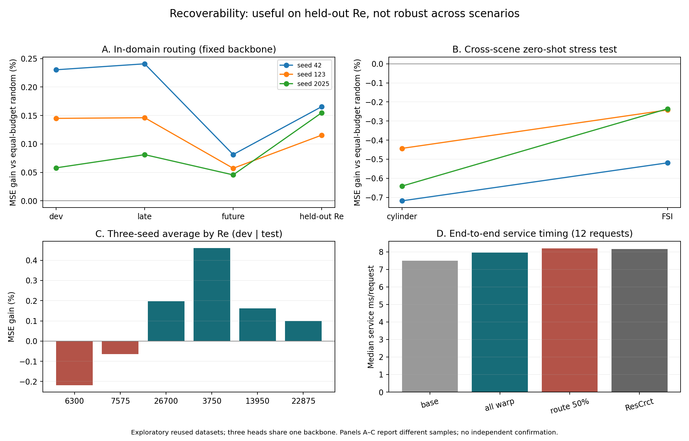

# DiPred 可纠正性：三种子、跨场景与机制诊断

**结论：目前有小幅的同场景路由信号，但没有形成跨场景、端到端成本上的稳定优势。** 因此不能把这一轮写成已经确认的通用可纠正性方法或ICML论文主结论。第6–20项的完成与不足逐条见[清单](../../recoverability_20261118/CHECKLIST.md)。

本轮以此前的观察结果为起点，于查看本轮保留Re和跨场景结果之前冻结[主协议](../../recoverability_20261118/PROTOCOL.md)：每个同步发报批次仅50%请求执行同一个warp动作，主要指标为收益路由相对同配额随机期望的轨迹等权物理MSE差。该冻结发生在既往多轮开发集探索之后，不是首次研究预注册。全部指标以具体动作、数据和成本为条件。

## 主要结果：原场景与跨场景

| 数据 | 轨迹/组 | 三种子平均相对随机改善 | 轨迹95%描述性CI（绝对物理MSE差） | 局限 |
|---|---:|---:|---:|---|
| development | 12 / 3 Re | 0.144% | [-4.91e-8, 6.54e-7] | 与后两段同轨迹，已有多轮使用 |
| late | 12 / 3 Re | 0.156% | [-1.84e-8, 5.92e-7] | 时间延伸，非独立工况 |
| future | 12 / 3 Re | 0.061% | [-4.72e-8, 3.11e-7] | 时间延伸，非独立工况 |
| 原manifest保留test | 12 / 3 Re | 0.145% | [6.61e-8, 2.78e-7] | 其轨迹不在本轮拟合/校准中，但项目历史使用过，不能称全新确认 |

置信区间先对三个种子的损失取平均，再以轨迹为单位bootstrap；它是**固定三种子、固定模型选择**的描述性区间，不把3种子×12轨迹当36个独立样本，也不包含主干重训、超参选择或历史探索不确定性。单种子test相对随机改善0.165/0.115/0.155%，种子间标准差0.026个百分点，底座是同一个冻结DiPred。三个保留Re组分别改善0.460/0.162/0.099%；开发组中6300、7575为负，收益集中在26700，不能只报告总体均值。完整[逐Re](primary_by_re.csv)、[单种子](primary.csv)、[种子统计](seed_summary.csv)和[轨迹表](policy_trajectories.csv)保存。

对于预先选定的8条cylinder和8条FSI实测轨迹，保留原归一化与源域模型、面积平均至32×64后零样本测试，三个种子的收益路由相对随机分别为 **−0.72/−0.44/−0.64%** 和 **−0.52/−0.24/−0.24%**；各单种子轨迹CI跨零。值得区分：两场景对所有请求运行warp的MSE均值仍改善约1.5–6.9%，是**选择哪些请求执行**没有泛化。原始流动场景、时间步、几何和单位与训练域不同；这些场景也已在项目中使用过，属于小样本压力测试，不是从未看过的新外部确认。参见[跨场景协议](../../recoverability_20261118/CROSS_SCENE_PROTOCOL.md)、[逐轨迹结果](cross_scene_trajectories.csv)。

## 固定预算不等于固定实际耗时

A100，12个同步请求、CPU物理输入和输出、单GPU串行预测，包含四调用主干、特征提取和调度；模型预加载后5次交错：

| 方法 | 每请求服务成本中位数 |
|---|---:|
| 原P | 7.50 ms |
| 全部执行warp | 7.95 ms |
| 50%收益路由 | 8.19 ms |
| 全部执行无反馈ResCrct | 8.16 ms |

在这个规模上，路由/PCA/CPU同步开销抵消了少运行的廉价warp。因此“动作次数减半”不能宣称延迟下降。测量含12请求分摊，不等同单请求延迟；初始化和训练排除。实际训练batch8、2000次更新，warp各seed约4.3–6.0秒，ResCrct约72.9–74.6秒。原始[计时样本](timing_samples.csv)及先前联合采样测量分别保留。

[算子profiler表](operator_flops_partial.csv)只包含PyTorch profiler能识别的算子；3D卷积、网格采样、部分反向与数据转换未可靠计数，示出的数字**不是总训练或推理FLOPs**。另按实际运行的Conv/Linear形状估算乘加数：[解析表](analytic_conv_linear_flops.csv)中四调用主干前向约6.28 GFLOPs、单次warp头约0.000187 GFLOPs、ResCrct头约1.80 GFLOPs；batch8训练头的前向与估计反向合计约0.00424 GFLOPs/步和39.92 GFLOPs/步。该估算包括3D卷积，仍排除投影、网格采样、激活和优化器等，不能充当总FLOPs；主干行的反向估算不适用于主干训练。完整FLOPs和包括采样/校准权重加载的所有强基线统一测量仍未完成。

## oracle、风险和可纠正性

校准90窗上，局部受限、读取真值的oracle平均：几何项解释约13.25%基础MSE，幅值/偏置项约8.83%，联合约18.77%；旧可部署warp约0.255%。几何与幅值存在交互，百分比不能相加。oracle是非凸优化的目标辅助参照，并非全局最优、可部署收益或严格条件均值上界。当前证据可确认**存在巨大的可学习性差距**，还不能把它唯一归因于信息不足、不可辨识或优化瓶颈。

以校正前真实MSE划分的风险与warp实际收益，在保留Re组的轨迹级Spearman相关为0.83/0.86/0.87；收益模型预测与实际收益相关0.68/0.70/0.88。但窗口级相关、预测误差、错误修正比例和不同种子均有明显变化：保留组中单窗口实际warp收益为负的比例约37%/53%/53%。平均风险较大不等于每个窗口值得修正。轨迹数仅12且事后分析不能证明相关结构跨域稳定。[二维分箱](risk_gain_joint_bins.csv)、[相关与后悔](risk_recoverability.csv)、[按时间批次精确预算的oracle后悔](decision_regret.csv)、[换ResCrct动作](trajectory_correlations.csv)均留存。

oracle本轮只用于评分之后的上限，实际收益标签由同一训练集拟合的warp产生，存在训练内乐观偏差；没有冒充交叉拟合。改为对ResCrct的收益进行排序时，相关系数不一致，不能假定一种动作的可纠正性自然迁移到其他动作。

针对训练内标签偏差，主结果揭示后另补了五折轨迹级交叉拟合：每条训练轨迹的收益由没有用它的未来真值训练的warp计算，再拟合同容量收益头。共享PCA仍使用全部训练输入但不使用目标；gain固定0.5。所得路由在dev/late/future/test相对随机的均值改善为0.227/0.218/0.061/0.173%。这只是**事后诊断**，评价集结果此前已查看，交叉拟合动作也只是完整训练动作的近似，不能替换原冻结主结果或视为新的独立确认。[分折与标签](crossfit_train_gains.csv)、[结果](crossfit_router_summary.csv)。

## F、长滚动与联合分布

所有表征使用相同16PC线性头和同一训练收益标签，在校准集选择ridge后，对历史开发段做诊断。development相对随机的收益：X约0.256%、P约0.251%、F_last约0.229%、F_mid99约0.274%、四调用确定性Fdet6000约0.270%；完整三时段在[表中](representation_diagnostics.csv)。差异小且属于已反复使用的开发数据；Fdet和扩散主干训练预算、数据及随机轨迹未完全匹配。这不支持“扩散F独有优势”，也不能排除不同表示在其他容量与数据量下有优势。

旧200帧自由滚动重新分解到逐块：基线平均MSE从第1块约0.000157升至第10块0.000415，warp第10块约0.000418；第10块基线/warp预测enstrophy约16.89/16.26，对应真值约22.43。还记录了高频误差占比和最大涡量位置偏移。它们揭示频谱与结构变化，不足以单独证明长期退步的因果原因。[逐轨迹表](rollout_spectrum_vorticity.csv)、[事后最好和最坏案例](case_examples.png)保留；案例只用于诊断，不作为挑选主结果的依据。

联合生成复用6个历史存档窗口的32成员场，对最大速度、峰值时空位置和相邻时间关联进行局部诊断；同时把每个样本映射到四个物理任务并和独立任务读出比较。6窗中AR+PCA诱导的脉动能90%样本区间没有一次包含直接读出、只包含一次真值；该现象提示任务不一致，但**6窗不是覆盖率推断样本**。五个任务的完整历史CRPS、ES/VS及逐Re对照见[依赖结构表](dependence_by_re.csv)，强尾部和联合覆盖确认仍未完成。

## 在线反馈、VOI与物理任务分解

新增真正改变模拟方程参数的受控试验：二维周期平流—扩散的粘性step、周期源项step、传感器偏置+噪声，以及稳定对照，各8轨迹，t=240变化；完整20帧反馈后才更新冻结的线性几何状态。变化后相对未校正P的MSE改善约39.19%、45.01%和22.02%，但稳定场景也有41.44%改善。简单平滑模拟场、源域归一化、固定周期边界意味着这些结果不能等同真实实验的漂移恢复；对照说明不能把全部收益归因于参数变化。预热3块后自由运行200帧也已存档，但变化仅在末尾出现，对变更后无反馈稳定性证据有限。非周期边界变化、真实场景时变动力学尚未完成。[协议](../../recoverability_20261118/DRIFT_PROTOCOL.md)、[逐窗](pde_drift_windows.csv)和[无反馈](pde_drift_free_summary.csv)可复核。

对原新增观测实验的300个窗口，每窗穷举128个**单点**实际同化收益，单点oracle平均存在正上限；解析VOI对128个实际收益的窗口内平均秩相关约−0.016至0.004，critic约0.033–0.059。单点oracle使用真值且仅是目标辅助上限，不说明8点组合可达到该收益，也不能断言risk接近最优或所有同化器失效。[单点诊断](observation_single_oracle.csv)保留每个窗口。

对1209窗、四任务计算`J(Y)−J(P)=L+Q`，并保存直接、XP、简单任务统计读出的结果。精确代数验证了二次余项的作用，但并未唯一辨识条件方差、系统偏差与表征的因果贡献；区域均u的退步仍保留。[分解表](task_decomposition_trajectories.csv)、[任务与场一致性](task_field_consistency.csv)和[相同校准过程](common_calibration_summary.csv)分别存档。经验区间覆盖不等于轨迹级同时覆盖保证。

## 可复现性、审计与未完成项

主路由3种子权重、校准增益、共享PCA、选择记录及原始数据manifest已打包为[primary_assets.tar.gz](primary_assets.tar.gz)。原DiPred主干 `reliability/checkpoints/current.pt` 已在仓库，其SHA-256为 `834260c9838b058d3e415b1efbd3fa19f7998884a36e46d14d62b10ed3ad8cfe`。使用[独立重放脚本](../../recoverability_20261118/standalone_reproduce.py)直接读取公开RealPDE原始HDF5和这些冻结权重，独立生成108窗主要表，与归档三个seed收益率最大差 `6.29e-7` 个百分点；并不等于从头重训六路线。因果发报重放不向决策函数提供真值，掩码全部一致、MSE最大差4.34e-11；这个检查是在结果已有后执行，不是假装二次盲测。

数据下载来源：[RealPDE Competition官方数据卡](https://huggingface.co/datasets/AI4Science-WestlakeU/RealPDE-Competition-Data/blob/main/README.md)；外场景数据来源：[RealPDEBench数据说明](https://realpdebench.github.io/datasets/)。环境、命令和模型依赖见[运行说明](../../recoverability_20261118/README.md)。主要协议、表格及有限统计一致性由[审计](final_audit.json)检查；统一的[相关工作表](../../recoverability_20261118/LITERATURE.md)不声称穷尽或完成论文复现。

本轮**没有完成**：真正新鲜的外部独立确认、底层DiPred多种子、完全匹配F/Fdet训练预算、真实时变边界与真实现场漂移、六方向完整再训练资产、完整训练/推理FLOPs及所有论文强基线同机复现。因此目前只能形成可纠正性问题的探索性证据与明确失败边界，尚不能宣称20项均已完成或具备最终论文级确认。
