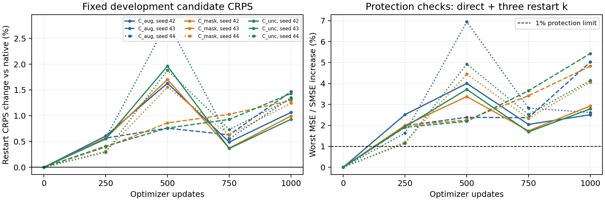

# 生成历史来源与父集合不确定性条件化：研究报告

本轮执行完成：符合原任务的三臂×种子42/43/44共九次训练，每次1000步，使用完整32成员经验CRPS，45个checkpoint；随后完成48个历史测试组和480个后续窗口组、统计及审计。实际起始HEAD=`50c25fdeb797de21703c039aeb13e6167b26bdbd`，分支dynamics；最终提交号见Git包含本报告的提交及交付消息。

**执行完成与经验收益分开判断。** 两类开发选择的步数分布为{0: 18}。科学候选与MSE保护候选的18项选择全部回退step0，意味着本次固定架构和预算下没有获得可选择的开发CRPS增益。正式选择模型的重启预测等于原生S，真实历史直接预测等于原生B；这些零差不证明来源或不确定性信息有价值，也不能证明该信息在所有其他参数化下都无效。所有36个非零候选的开发结果单独披露，没有用回退掩盖非零网络。

## 训练范围纠错和探索性边界

此前实现误把k0直接样本加入训练，260/1000更新不满足任务“每个训练样本k∈{2,5,10}”要求。该批9000更新、45权重、原协议/配置/代码、开发结果和中止评价完整保存在 `invalid_direct_training/`，不计为有效九次训练，也不进入任何有效选择/统计。纠正仅恢复原任务训练域；1760参数、lr=.001、Adam、初始化种子、1000步、loss、候选和选择门槛不变，没有根据结果重新搜索超参。详见PROTOCOL_CORRECTION.md。

有效批次在训练前重新固定协议并重新预检。训练1000共同样本中k2/5/10为356/297/347，覆盖46条原训练轨迹；k0只用于直接预测预检、开发保护和正式评价。全部三臂使用同一抽样顺序与实际噪声，三种子只改变对齐的适配器初始化。错误批次冻结原生A/B/C/S不依赖任何适配权重，锁定manifest并核对哈希后允许复用；错误适配权重和分数不复用。

历史测试及后续时段在先前研究与该范围纠错前均已有探索使用。所有结果都属于探索性，不能称新盲测；修复本身不恢复独立性。只有3个测试Re组，按12条轨迹bootstrap不能代表跨全部Re推广。

## 数据、模型与完整集合目标

数据来自 `DiPred+ResCrct/OLD/REALPDE/realpdebench-competition/data/train_real/`，u/v空间`::2,::2`得到32×64。46/12/12原轨迹及Re隔离沿用旧划分，train/dev/test历史起点400/420、两独立重复。后续测试固定历史440至820，步长20，共20窗口×12轨迹×2重复。源HDF5完整哈希、原缓存/成员/噪声身份在data_sources、config、evaluation/extension manifests中，未使用500000系列缓存。

子模型保留原生20帧历史→联合20帧输出、四步99/66/33/0去噪。原主干、父生成器及归一化不更新。相同1760参数适配器输入101槽：标准化历史40、来源mask20、父离散度40、去噪步1；卷积101→8(1×1)、8→8(3×3)、8→40(1×1)，中间SiLU，最后层零初始化。每次去噪都把适配量加入历史条件，原DynamicsNet重新计算history.diff/scale，四步完整图训练。

C_aug屏蔽mask/std；C_mask仅mask有效；C_unc两者有效。mask仅末k位置=1；std为父完整32成员前k帧的逐点总体标准差除冻结通道std，放到末k位置；真实位置0仅表示无生成来源集合离差，不意味着物理无不确定性。每个父成员保持原时空身份并对应自己的一个子噪声，未先均值化父集合。输入函数不接受truth。

训练使用完整32成员、完整子20帧标准化经验CRPS：mean|p_i−y|−sum_ij|p_i−p_j|/(2M²)。成员距离项实际参与梯度，无Monte Carlo小成员近似、无共同平移简化loss。每次1000步Adam，lr=.001，batch1个完整成员块；无新增正则、JVP目标或误差监督。父离散度在当前未来标签读取前计算，未来仅进入损失/评分。

物理索引（0基）：H=[start,start+20)，混合H'=H[k:]+A_i[:k]，子完整输出[start+20+k,start+40+k)。tail取子前20−k，对齐B后20−k；joint为同成员A前k+子前20−k，对齐原完整20未来；direct用全真实H、零mask/std及原B噪声，与原B完整20比较。正式全部预测先记hash并发布，再读评分truth；训练和开发标签未进入发布条件。

## 预检和实现证据

有效PREFLIGHT通过：完整CRPS显式成员对数值误差0、梯度误差1.73e-18，gradcheck通过；真实网络成员距离项适配器梯度范数0.0342788，四次适配输出梯度RMS均非零。24组零初始化预测满足maxabs≤2e−6；参数/初值对齐、时间/成员/噪声、mask/std位置、未来污染和冻结主干检查通过。非零固定诊断适配器改变成员间差，非最终共同平移。

EVALUATION_TESTS验证完整评分、逐lead汇总、显式时间协方差和拼接成员；PLAN_CHECKS验证528组覆盖、目标帧可用、Re隔离及145920个旧+后续原生种子唯一。tests.log、evaluation_tests.log及相应JSON保留。最初Python3.8路径API错误在任何优化前退出，产物单独保存在invalid_direct_training/preupdate_failure/，兼容修复后预检，未隐藏失败。

## 开发选择和非零候选披露

每个arm/seed在0/250/500/750/1000步保留候选。科学选择最小开发restart-tail CRPS，轨迹等权、三个k等权；保护选择另要求各k重启尾段及direct的原MSE/SMSE均≤对应原生均值1.01，且CRPS严格改善才可离开step0。这个1%规则是描述性保护界，不是统计非劣证明。

下表“最佳非零”仅为审查四个预定非零候选，不是新增正式选择。原生选择CRPS为0.095053792。

| 臂 | 种子 | 最佳非零步 | 开发CRPS | 相对原生% | 最差MSE增幅% | 保护项 | 合格 | 科学步 | 保护步 |
| --- | --- | --- | --- | --- | --- | --- | --- | --- | --- |
| C_aug | 42 | 750 | 0.09551842 | 0.4888032 | 2.043348 | smse_k5 | False | 0 | 0 |
| C_aug | 43 | 250 | 0.09559096 | 0.565123 | 1.986552 | smse_k0 | False | 0 | 0 |
| C_aug | 44 | 750 | 0.09557646 | 0.5498656 | 2.825353 | smse_k10 | False | 0 | 0 |
| C_mask | 42 | 750 | 0.09540578 | 0.3702997 | 1.74012 | smse_k0 | False | 0 | 0 |
| C_mask | 43 | 250 | 0.09542621 | 0.3917979 | 1.999254 | smse_k0 | False | 0 | 0 |
| C_mask | 44 | 250 | 0.09534682 | 0.3082767 | 1.195557 | smse_k0 | False | 0 | 0 |
| C_unc | 42 | 750 | 0.09539938 | 0.3635714 | 1.6885 | smse_k5 | False | 0 | 0 |
| C_unc | 43 | 250 | 0.09544234 | 0.4087686 | 1.910202 | smse_k0 | False | 0 | 0 |
| C_unc | 44 | 250 | 0.09533277 | 0.2934976 | 1.142297 | smse_k0 | False | 0 | 0 |

完整其他指标包括ES、原MSE/SMSE、方差、宽度和时间均值场CRPS在development.csv及development_summary.csv；36个非零候选逐轨迹/Re/通道及与原生、同一步臂间的配对差在development_nonzero_*。同一步数的来源/不确定性增量如下（平均三种子后按原轨迹bootstrap，98.333%区间）：

| 步 | k | 差 | CRPS差 | 下界 | 上界 |
| --- | --- | --- | --- | --- | --- |
| 250 | 2 | C_mask minus C_aug | -0.0001497044 | -0.0003946175 | -1.34021e-05 |
| 250 | 2 | C_unc minus C_mask | -8.070155e-06 | -4.46932e-05 | 9.875015e-06 |
| 250 | 5 | C_mask minus C_aug | -0.0001319275 | -0.0003478109 | 2.853448e-05 |
| 250 | 5 | C_unc minus C_mask | 1.874446e-07 | -2.903805e-05 | 1.742073e-05 |
| 250 | 10 | C_mask minus C_aug | -0.0001686965 | -0.0004155324 | 3.974749e-05 |
| 250 | 10 | C_unc minus C_mask | -5.152139e-06 | -6.574377e-05 | 3.69578e-05 |
| 1000 | 2 | C_mask minus C_aug | -0.0001099583 | -0.0003210333 | 0.0002246312 |
| 1000 | 2 | C_unc minus C_mask | -3.965231e-05 | -0.0001121964 | -2.835495e-07 |
| 1000 | 5 | C_mask minus C_aug | -8.719106e-05 | -0.0002322659 | 0.0001800707 |
| 1000 | 5 | C_unc minus C_mask | 3.517021e-05 | -1.779778e-05 | 8.318268e-05 |
| 1000 | 10 | C_mask minus C_aug | -0.0001335697 | -0.0002697805 | 7.585471e-05 |
| 1000 | 10 | C_unc minus C_mask | 0.000154435 | -4.167399e-05 | 0.0005226121 |

局部开发差异不等于独立确认，也不能把C_mask相对C_aug的小改善当作超过原生模型。所有模型、选择/权重hash先冻结，再评分历史测试/后续窗口；未根据测试追加候选或改变规则。

## 冻结选择的正式质量

下面为原生B/S的全部探索测试/后续窗口、两通道整体均值。若选择step0，C_aug/C_mask/C_unc两种政策及各seed对应S（tail/joint）或B（direct）逐值相同；完整政策/seed表仍全部输出，不把相同结果重复解释为独立证据。

| 划分 | k | 视图 | 基线 | CRPS | 完整ES | 原MSE | SMSE | 标准化方差 | 标准化90%宽度 | 时间均值CRPS |
| --- | --- | --- | --- | --- | --- | --- | --- | --- | --- | --- |
| test | 2 | tail | B | 0.09001993 | 0.1693164 | 0.0001212451 | 0.0589971 | 0.01535879 | 0.2784567 | 0.05515341 |
| test | 2 | tail | S | 0.09275128 | 0.1721277 | 0.0001262031 | 0.06095875 | 0.01642781 | 0.2854339 | 0.05767437 |
| test | 2 | joint | B | 0.08471036 | 0.1618243 | 0.0001115804 | 0.05383794 | 0.01402096 | 0.261592 | 0.05033324 |
| test | 2 | joint | S | 0.08717789 | 0.1644775 | 0.000116058 | 0.05560637 | 0.01498333 | 0.2678741 | 0.05279969 |
| test | 5 | tail | B | 0.09506663 | 0.1784769 | 0.0001306612 | 0.06548922 | 0.01645974 | 0.2883783 | 0.0618736 |
| test | 5 | tail | S | 0.09837954 | 0.1823216 | 0.0001348413 | 0.0687058 | 0.01796044 | 0.2979919 | 0.06537835 |
| test | 5 | joint | B | 0.08471036 | 0.1618243 | 0.0001115804 | 0.05383794 | 0.01402096 | 0.261592 | 0.05033324 |
| test | 5 | joint | S | 0.08723412 | 0.1650393 | 0.0001148764 | 0.05628444 | 0.01515356 | 0.2688199 | 0.05327366 |
| test | 10 | tail | B | 0.1011872 | 0.1898725 | 0.0001425468 | 0.07373388 | 0.01746678 | 0.2961924 | 0.07510359 |
| test | 10 | tail | S | 0.101863 | 0.1886328 | 0.0001431701 | 0.07385717 | 0.01851565 | 0.3017055 | 0.07661121 |
| test | 10 | joint | B | 0.08471036 | 0.1618243 | 0.0001115804 | 0.05383794 | 0.01402096 | 0.261592 | 0.05033324 |
| test | 10 | joint | S | 0.08511589 | 0.1611502 | 0.0001122984 | 0.0539563 | 0.01455588 | 0.2643702 | 0.05169854 |
| extension | 2 | tail | B | 0.09234668 | 0.1771862 | 0.0001250176 | 0.06547187 | 0.01546702 | 0.2797336 | 0.05790255 |
| extension | 2 | tail | S | 0.09456589 | 0.1783484 | 0.0001277709 | 0.06617201 | 0.01666485 | 0.2877113 | 0.06043561 |
| extension | 2 | joint | B | 0.08683222 | 0.1692794 | 0.0001147775 | 0.05968676 | 0.01412042 | 0.2627919 | 0.05285714 |
| extension | 2 | joint | S | 0.08883112 | 0.1703781 | 0.0001172569 | 0.0603172 | 0.0151983 | 0.2699686 | 0.05532466 |
| extension | 5 | tail | B | 0.09792122 | 0.1875039 | 0.000136285 | 0.0732462 | 0.01656146 | 0.2896016 | 0.06507949 |
| extension | 5 | tail | S | 0.1000536 | 0.1876212 | 0.0001386486 | 0.07367496 | 0.01812296 | 0.2998949 | 0.06819077 |
| extension | 5 | joint | B | 0.08683222 | 0.1692794 | 0.0001147775 | 0.05968676 | 0.01412042 | 0.2627919 | 0.05285714 |
| extension | 5 | joint | S | 0.08843591 | 0.1694181 | 0.0001165518 | 0.06000959 | 0.01529052 | 0.2704963 | 0.05553252 |
| extension | 10 | tail | B | 0.1051341 | 0.2023011 | 0.0001520038 | 0.0847666 | 0.0175487 | 0.2973023 | 0.07916143 |
| extension | 10 | tail | S | 0.1056011 | 0.1999319 | 0.0001510725 | 0.08383337 | 0.01860301 | 0.3029729 | 0.08049448 |
| extension | 10 | joint | B | 0.08683222 | 0.1692794 | 0.0001147775 | 0.05968676 | 0.01412042 | 0.2627919 | 0.05285714 |
| extension | 10 | joint | S | 0.08706752 | 0.167958 | 0.0001143238 | 0.05921331 | 0.01465096 | 0.2656191 | 0.05410603 |

这里CRPS/ES/SMSE及standardized列用冻结训练尺度；mse/variance/width90保留原尺度。完整ES覆盖该视图所有时间/空间，不由逐lead ES平均替代。时间均值场CRPS先对每条路径沿物理时间平均，再评价。

S相对B的轨迹配对差（正值为S分数更大，98.333%区间）：

| 划分 | k | 视图 | 指标 | S−B | 下界 | 上界 |
| --- | --- | --- | --- | --- | --- | --- |
| test | 2 | tail | crps | 0.002731351 | 0.001075288 | 0.004276774 |
| test | 2 | tail | energy | 0.00281137 | -0.0003388748 | 0.005678552 |
| test | 2 | tail | mse | 4.958017e-06 | -4.425668e-07 | 1.264626e-05 |
| test | 2 | tail | smse | 0.001961651 | -0.0005036468 | 0.004749619 |
| test | 2 | joint | crps | 0.002467534 | 0.0009790562 | 0.003855924 |
| test | 2 | joint | energy | 0.002653158 | -0.0003194402 | 0.005354903 |
| test | 2 | joint | mse | 4.477591e-06 | -3.821694e-07 | 1.141036e-05 |
| test | 2 | joint | smse | 0.001768432 | -0.0004487861 | 0.00427788 |
| test | 5 | tail | crps | 0.003312905 | 0.001297925 | 0.005500031 |
| test | 5 | tail | energy | 0.003844673 | 0.001147394 | 0.006870932 |
| test | 5 | tail | mse | 4.18013e-06 | -5.203813e-07 | 9.550601e-06 |
| test | 5 | tail | smse | 0.003216587 | 0.0007637172 | 0.006632041 |
| test | 5 | joint | crps | 0.002523762 | 0.001025405 | 0.004155373 |
| test | 5 | joint | energy | 0.003214983 | 0.0009624371 | 0.005740655 |
| test | 5 | joint | mse | 3.296029e-06 | -2.027265e-07 | 7.479199e-06 |
| test | 5 | joint | smse | 0.002446496 | 0.0006085146 | 0.005029847 |
| test | 10 | tail | crps | 0.0006757299 | -0.001116633 | 0.0022207 |
| test | 10 | tail | energy | -0.001239637 | -0.00416953 | 0.001555611 |
| test | 10 | tail | mse | 6.233041e-07 | -9.556118e-06 | 1.030688e-05 |
| test | 10 | tail | smse | 0.0001232865 | -0.002461381 | 0.002967673 |
| test | 10 | joint | crps | 0.0004055293 | -0.0004754354 | 0.001142434 |
| test | 10 | joint | energy | -0.0006741172 | -0.002521304 | 0.001050608 |
| test | 10 | joint | mse | 7.180573e-07 | -4.149436e-06 | 5.942104e-06 |
| test | 10 | joint | smse | 0.0001183573 | -0.00113327 | 0.001550794 |
| extension | 2 | tail | crps | 0.002219218 | 0.0006397062 | 0.00380346 |
| extension | 2 | tail | energy | 0.001162224 | -0.001636757 | 0.00339887 |
| extension | 2 | tail | mse | 2.753314e-06 | -1.615552e-06 | 5.653422e-06 |
| extension | 2 | tail | smse | 0.0007001384 | -0.001161028 | 0.00196416 |
| extension | 2 | joint | crps | 0.001998901 | 0.0005772314 | 0.003423778 |
| extension | 2 | joint | energy | 0.001098635 | -0.001540992 | 0.003207469 |
| extension | 2 | joint | mse | 2.479368e-06 | -1.453176e-06 | 5.0898e-06 |
| extension | 2 | joint | smse | 0.0006304406 | -0.001044981 | 0.001768777 |
| extension | 5 | tail | crps | 0.002132341 | -0.0001215235 | 0.004420221 |
| extension | 5 | tail | energy | 0.00011734 | -0.003723101 | 0.003208218 |
| extension | 5 | tail | mse | 2.363656e-06 | -2.469356e-06 | 5.608224e-06 |
| extension | 5 | tail | smse | 0.0004287629 | -0.001960349 | 0.001880035 |
| extension | 5 | joint | crps | 0.001603697 | -8.529409e-05 | 0.003318012 |
| extension | 5 | joint | energy | 0.0001386184 | -0.003033212 | 0.002687258 |
| extension | 5 | joint | mse | 1.774312e-06 | -1.853074e-06 | 4.199386e-06 |
| extension | 5 | joint | smse | 0.0003228339 | -0.001468935 | 0.001410244 |
| extension | 10 | tail | crps | 0.0004670346 | -0.001725588 | 0.00258875 |
| extension | 10 | tail | energy | -0.002369225 | -0.005690002 | 0.0004911674 |
| extension | 10 | tail | mse | -9.312958e-07 | -9.578946e-06 | 3.377141e-06 |
| extension | 10 | tail | smse | -0.0009332319 | -0.003619863 | 0.00116921 |
| extension | 10 | joint | crps | 0.000235299 | -0.0008589143 | 0.001283808 |
| extension | 10 | joint | energy | -0.001321457 | -0.003248993 | 0.000317726 |
| extension | 10 | joint | mse | -4.537402e-07 | -4.717047e-06 | 1.674893e-06 |
| extension | 10 | joint | smse | -0.00047345 | -0.001802494 | 0.000552648 |

适配器−S、C_mask−C_aug、C_unc−C_mask、适配器−B以及direct适配器−B的全部seed/policy/原轨迹/Re/通道区间见paired_*。step0相对S和臂间差为0意味着未获经验增益，不能当作统计功效证明信息无用。选择适配器相对B的tail/joint差就是上表的S−B，直接预测差为0；不能宣称原始20→20预测任务改善。

## 接缝、多样性、时间结构与分布诊断

| 划分 | k | 组 | 接缝增量RMS | 增量对真值MSE | 父自身增量RMS | ACF误差 | 相对B时间相关差 |
| --- | --- | --- | --- | --- | --- | --- | --- |
| test | 2 | B | 0.1033214 | 0.007354389 | 0.1032645 | 0.06465468 | 0 |
| test | 2 | S | 0.1140169 | 0.007631208 | 0.1032645 | 0.06627097 | 0.06396432 |
| test | 5 | B | 0.09845781 | 0.01073667 | 0.09843867 | 0.06465468 | 0 |
| test | 5 | S | 0.1107437 | 0.01295702 | 0.09843867 | 0.06427806 | 0.06285073 |
| test | 10 | B | 0.09405602 | 0.01555466 | 0.09439236 | 0.06465468 | 0 |
| test | 10 | S | 0.1015346 | 0.01663074 | 0.09439236 | 0.06062552 | 0.04984525 |
| extension | 2 | B | 0.109353 | 0.007249528 | 0.1093579 | 0.07441243 | 0 |
| extension | 2 | S | 0.1195565 | 0.007347912 | 0.1093579 | 0.07409262 | 0.06437148 |
| extension | 5 | B | 0.1020934 | 0.01096891 | 0.1020972 | 0.07441243 | 0 |
| extension | 5 | S | 0.1144137 | 0.01276774 | 0.1020972 | 0.07114387 | 0.06377073 |
| extension | 10 | B | 0.09387115 | 0.01523561 | 0.09389977 | 0.07441243 | 0 |
| extension | 10 | S | 0.1008989 | 0.01619519 | 0.09389977 | 0.07008994 | 0.04955799 |

接缝是同成员生成前缀末帧到子首帧的标准化增量；与真值增量误差及父自身k−1→k增量共同解释，不要求独立成员逐点相等。时间结构同时保存u/v各lag ACF、逐成员中心化20×20时间协方差/相关及B/C独立采样对照；矩阵文件在temporal缓存，经manifest索引，评分表保留Frobenius差。

冻结选择为step0时，成员方差、90%宽度和相关结构按构造保持原生S/B，说明回退安全，不证明学到非零适配器同时提升质量与多样性。非零候选在开发表有spread/width代价，但并未以未选网络构造测试改善结论。32成员和固定时间投影限制高维依赖识别。

重启分布指标为独立ED_U(B_tail,预测_tail)−ED_U(B_tail,C_tail)，保留负数；B/C独立于父和子。原生B对自身的U留空，耦合的适配/S不套独立U。全指标见scores_*及paired_*；分布距离不能替代真值评分，未要求独立随机路径相等。

## 八个科学问题

1. **同等适配训练是否足够改善重启？** 在本次1760参数、1000步完整集合CRPS协议下，开发选择未获得可用增益；不支持“已经足够”。这限定于该架构/数据/优化预算。
2. **来源标记是否有独立收益？** 正式科学选择未超过C_aug；开发同一步比较存在的小差异仅属探索，不满足预设跨测试/后续时段/种子/Re稳定增量标准，不能宣称来源条件有效。
3. **父离散度是否有额外价值？** 正式选择未超过C_mask；未证实增量。不能以显式输入了std就宣称网络利用了有益不确定性机制。
4. **完整概率质量与必要点指标是否同时改善？** 没有选出的非零网络实现全面提升；保护回退保留原生指标。所有CRPS/ES/MSE/SMSE取舍及不合格保护项均披露。
5. **是否保留多样性与时间相关？** 正式回退与原生逐值一致，因此保留；这不是学得的结构改善，也不能从方差非零推出所有时空相关准确。
6. **是否跨Re、通道、种子稳定？** 没有稳定正收益。保留三种子、u/v、三个Re、逐轨迹/窗口/lead表；种子及像素没有被当作独立物理样本。
7. **是否优于B，还是仅改善S？** 选择模型重启等于S，连改善S也未实现；与B差异按对应tail/joint正式表报告。全真实历史直接预测等于B。不能把两次生成成本称为单次原生任务的同预算改进。
8. **是否有足够证据启动物理时间一致性训练？** 没有。上一轮JVP仅说明部分输入响应可局部近似，不证明一致性loss的收益，本轮没有新增JVP目标或一致性正则。固定九次结果结束，不自动扩容、加步、加loss或选测试集。

## 统计单位、成本与可复核性

每条原轨迹内先平均窗口与两随机重复；每seed单报，mean3先在同一原轨迹内平均三个训练seed，再对12轨迹等权bootstrap10000次seed123。95%和三k Bonferroni98.333%区间全部保留，不把窗口、成员、像素或训练seed当独立轨迹。不声称所有指标/Re/通道的全族同时覆盖。

有效训练+开发评价851.891秒（含数据预载入时间另见training_process_start），正式生成/评分624.183秒；预检3.444秒。有效训练峰值allocated显存1.551GiB，正式评价0.457GiB。有效新缓存13,109,482,412bytes=12.209GiB。

新增原生extension路径39552，复用纠错批次冻结原生路径52608；有效正式新增非零适配路径0（step0直接复用）。数据/原缓存预载、权重加载、评分、写盘与生成不可混作部署延迟。每个重启预测仍需要父+子两次四步，共8个网络前向，单次原生B只需4次；三k可共享父。训练的9000步完整32成员四步前向及反向成本不等于9000次推理。

额外作废批次训练+开发932.820秒、9000更新和45checkpoint，已完成321个评价组、生成274组原生extension；其最后进度/中止堆栈见invalid_direct_training/evaluate.log。所有这部分成本都不能隐藏在有效实验的预算或部署时延中，计算总开销见RESOURCE_ACCOUNTING.json。原生缓存可重用，但错误适配实验不作为正式证据。

VERIFICATION通过：有效9000更新、45checkpoint和18选择复算，528组身份/输入/noise及先发布后真值事件，所有2,576,640个lead明细索引/归约，9组固定轨迹/Re/窗口的3402评分复算（最大绝对差0），2580个CRPS轨迹区间复核。旧结果与checkpoint哈希保持不变。审计子集用于数值核验，不替代完整528组研究统计。

复跑命令见research/provenance_uncertainty_conditioning/README.md；实际执行命令见EXECUTED_COMMANDS.json；文件清单及hash见REVIEW_FILES.md/ARTIFACT_SHA256.json。大型原生与时间结构缓存留Workspace/runs，45个小适配checkpoint、日志、压缩明细、报告与全部hash随Git交付。

## 最终区分与停止

**执行完成：** 符合训练k约束的固定九次实验、两类冻结选择、全部正式窗口、统计、数值/身份复核完成；作废批次单独归档。

**经验收益：** 当前固定实验未获得可选择的重启CRPS改善，正式模型回退原生。没有部署改进结论。

**机制支持：** 来源/离散度的增量价值未得到稳定支持；共同训练数据/容量控制使比较可解释，但零选择不能识别信息本身是否有用。

**未识别因素：** 轻量历史扰动参数化、固定步数/学习率、训练窗口覆盖、模型表达与历史截断可能影响结果；本轮不通过改超参补救，也不据负结果证明PDE机制。

**仍需独立验证：** 若未来另立项，需要新的独立原轨迹/Re及独立选择过程；既有历史测试/延伸时段不能提供新盲测确认。本轮按协议结束，不自动开始下一研究阶段。

## 直接预测与审计计数补充

全部选择step0，因此正式selected_output_replay_paths和cached_outputs_checked为0；这表示没有选中非零适配器需要额外采样，不能将该0当成非零网络已经通过测试重放。零适配器与原生的实际数值复现由训练前24组预检提供，正式原生缓存的全部成员/输出/噪声哈希和历史测试旧评分由VERIFICATION核对。

全观测直接预测的原生基线：

| 划分 | CRPS | ES | 原MSE | SMSE | 标准化方差 | 标准化90%宽度 |
| --- | ---: | ---: | ---: | ---: | ---: | ---: |
| test | 0.084710358 | 0.16182432 | 0.00011158039 | 0.053837939 | 0.014020963 | 0.26159202 |
| extension | 0.086832217 | 0.16927944 | 0.00011477753 | 0.059686759 | 0.014120415 | 0.26279195 |

C_aug/C_mask/C_unc的科学及保护选择在三个seed上均与上述直接基线逐值相同，CRPS/ES/MSE/SMSE/方差/宽度差皆为0。非零候选的直接预测代价仍完整保留在development_summary.csv中，不以回退的安全性替代非零适配器的保护检验。
