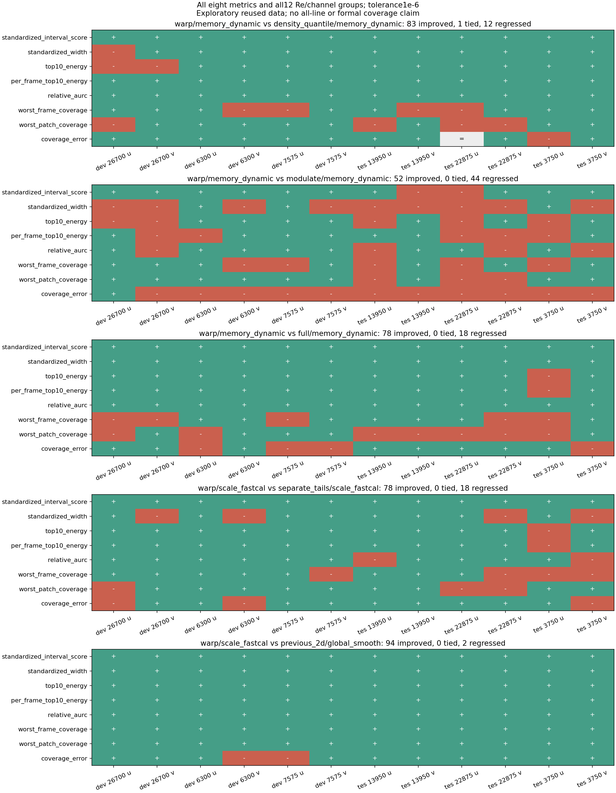
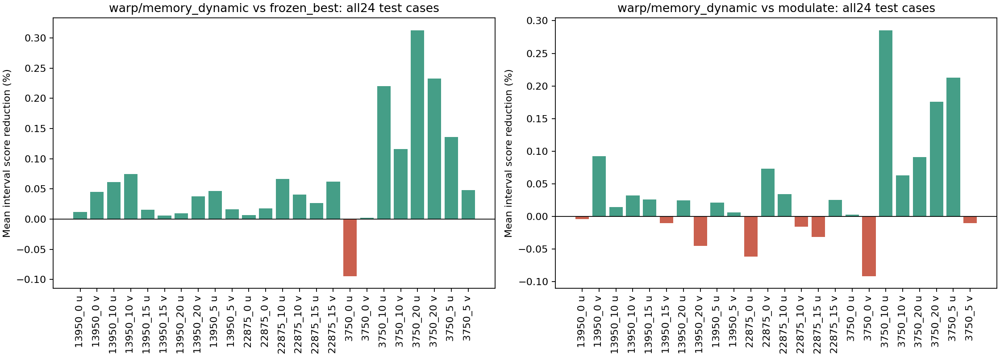

# 完整动态风险记忆证据

- `per_case.json`：全部11,232条窗口/通道结果，包括冷启动与两种固定在线策略。
- `summary.json`、`test_macro.json`：完整分组及汇总值。
- `previous_reference_warm_summaries.json`：55个既有参考组合；当前6个组合在summary中，共61个。
- `regression_counts.json`：366组原8指标×12工况/通道的96项比较，容差1e-6。
- `counterexamples.json/csv`：全部9,536条退步，不筛选隐藏。
- `audited_progress.json`：与上次发布比较的83改善/1持平/12退步及各项数值。
- `paired_trajectory_scores.json`：全部测试轨迹/通道配对，不只展示改善案例。
- `dynamic_memory_96cells.png`、`dynamic_memory_paired_scores.png`及CSV：完整选定比较与逐轨迹图。
- `analysis_verification.json`：从逐窗口数据重算全部比较的审计；`portable_inference_audit.json`为此次仓库实现与原研究版本的实际预测核对。

运行 `python analyze_dynamic_memory.py` 重算全部96项比较及反例，只需要Python标准库。Score/Width为训练通道标准化无量纲值；覆盖率是逐点边际量。均为反复使用历史数据的探索性结果，原迁移机制门槛未通过，无完整20帧联合覆盖或全面优于强参考的结论。

