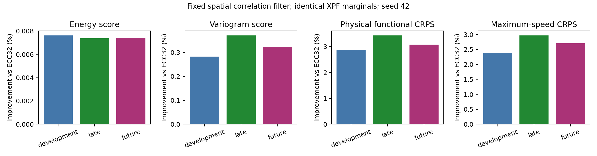
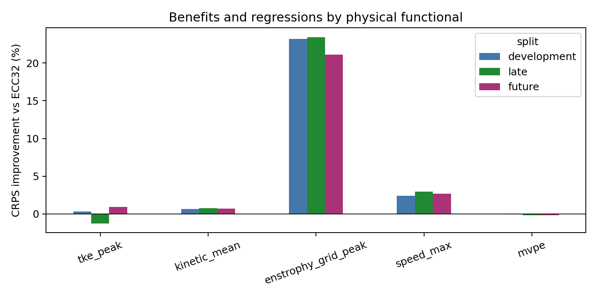

# RealPDE 联合概率探索：已出现可复核收益，物理机制优势仍有限

## 结论

本轮找到了**保持逐点XPF分位分布完全不变、仅修正整场样本相关结构**的正向收益：固定空间滤波后再做秩重排，相对原版XPF49 + 真实32条扩散路径ECC，开发／后期／更晚窗口的物理泛函平均CRPS分别降低 **2.88%／3.43%／3.08%**；最大速度CRPS分别降低 **2.38%／2.97%／2.70%**，三个Re组均改善。ES平均略有改善，12条轨迹在三个时间段均改善；VS平均改善约0.28–0.37%，不是每条轨迹都改善。

这是联合分布结构上的收益，**边际CRPS没有变化**。它满足小规模探索中“出现正向收益”的经验标准，但目前最稳健的是简单空间相关修正，不能当作已完成的ICML级新物理算法。复杂投影/输运没有全面胜过这个控制；没有结论证明六条研究路线全部失败。

## 数据、选择与可比性

- 阅读了用户指定附件和项目已有RealPDE、XPF49、ECC、Warp/Modulate报告及代码。只用原RealPDE，不读5pde。冻结四步DiPred和49个独立双分位头，无新主干训练。本轮随机设置统一seed42；32条场样本的随机噪声编号不代表32个训练种子。
- 训练819窗口/46轨迹用于经验残差库与物理泛函归一化、75%/90%事件阈值；校准90窗口/10轨迹用于预定准则选方法。训练、校准、开发按原manifest的轨迹和Re组互斥。
- 开发108窗口/12轨迹，start=0..160步长20；后期120窗口，start=200..560步长40；更晚72窗口，start=600..800步长40。后两个时间段仍是同12条开发轨迹，不是新轨迹或新Re的独立测试。该开发集历史上已反复用于研究，区间仅用于探索。
- 所有方法固定32个样本。主比较使用相同XPF32个中点分位值、相同点预测、相同32条扩散路径；只改变样本成员排列。原生Diffusion另列，不能把边际校正收益当作新联合模块收益。
- 选择准则预先写入协议：校准集ES、VS和5个标准化物理泛函CRPS相对ECC32的比值平均。空间修正固定β=0.5、一次3×3滤波，之后不在开发/后期/更晚数据上调参。选择文件散列在future_protocol.json中冻结。

## 有收益的方法与数学机制

设Q_j是固定位置/变量/时刻j的32个XPF分位值。ECC初始场为Y，m是32个成员逐点均值，δ=Y−m。令S为独立作用于每个时刻和速度分量的3×3空间均值滤波（非周期边界延拓）：

`Z = m + 0.5 δ + 0.5 Sδ`，`Y'_{k,j} = Q_j[rank_j(Z_{k,j})]`。

因此每个位置的有序32个样本值保持逐位一致，有限样本边际CRPS、均值、区间宽度也保持不变；改善来自跨点/时间/变量排列的变化。此算子本身没有证明新的物理原创性，适合作为后续方法必须击败的便宜强对照。

正向百分比表示降低评分，负值表示退步：

| split | ES_gain_percent | VS_gain_percent | functional_CRPS_gain_percent | speed_max_CRPS_gain_percent | MVPE_CRPS_gain_percent |
| --- | --- | --- | --- | --- | --- |
| calibration | 0.011874 | 0.334102 | 1.174918 | 2.589045 | -0.162651 |
| development | 0.007629 | 0.283014 | 2.881061 | 2.382891 | -0.058482 |
| late | 0.007389 | 0.371519 | 3.432249 | 2.971152 | -0.165994 |
| future | 0.007406 | 0.324437 | 3.078347 | 2.703469 | -0.172521 |



5个泛函是：空间速度涨落TKE峰值、平均动能、物理涡量平方峰值、最大速度、相对共同P的最大向量误差MVPE。各自CRPS除以训练集该泛函标准差，再等权平均。平均增益较受涡量泛函和高Re轨迹影响，不能只报告平均数。



## 逐轨迹证据与反例

下表CI是“基线评分−方法评分”的**绝对差**，相对百分比另列。每次重采样整条轨迹，不按像素/窗口伪造独立样本；同Re轨迹相关，不能外推新Re置信度。物理泛函平均CRPS的开发和更晚CI仍跨0；最大速度CRPS的三个时间段CI均为正。

| split | metric | relative_percent | ci_low | ci_high | wins | trajectories |
| --- | --- | --- | --- | --- | --- | --- |
| development | es | 0.007629 | 0.000006 | 0.000021 | 12 | 12 |
| development | functional_crps | 2.881061 | -0.000134 | 0.005131 | 7 | 12 |
| development | crps_speed_max | 2.382891 | 0.000575 | 0.002501 | 10 | 12 |
| development | crps_mvpe | -0.058482 | -0.000511 | 0.000198 | 6 | 12 |
| late | es | 0.007389 | 0.000006 | 0.000019 | 12 | 12 |
| late | functional_crps | 3.432249 | 0.000015 | 0.005526 | 8 | 12 |
| late | crps_speed_max | 2.971152 | 0.001151 | 0.002942 | 12 | 12 |
| late | crps_mvpe | -0.165994 | -0.000656 | -0.000013 | 5 | 12 |
| future | es | 0.007406 | 0.000007 | 0.000018 | 12 | 12 |
| future | functional_crps | 3.078347 | -0.000168 | 0.005214 | 9 | 12 |
| future | crps_speed_max | 2.703469 | 0.000922 | 0.002565 | 11 | 12 |
| future | crps_mvpe | -0.172521 | -0.000687 | 0.000012 | 3 | 12 |

三个Re组的最大速度CRPS均改善；泛函平均并非如此：

| split | Re_group | speed_gain_percent | functional_gain_percent |
| --- | --- | --- | --- |
| development | 6300 | 1.666528 | -0.558029 |
| development | 7575 | 3.094179 | 0.602963 |
| development | 26700 | 2.396749 | 4.288416 |
| late | 6300 | 2.184007 | 0.540029 |
| late | 7575 | 3.300684 | 0.768137 |
| late | 26700 | 3.510746 | 4.996495 |
| future | 6300 | 2.059642 | -0.539805 |
| future | 7575 | 2.921605 | 1.288055 |
| future | 26700 | 3.010148 | 4.497555 |

退步必须保留：后期TKE CRPS约退步1.25%；MVPE在开发/后期/更晚平均退步约0.06%/0.17%/0.17%。Brier平均变化很小，部分训练事件阈值在开发几乎无正例，不能以其微小变化声称极端风险预测已解决。

## 已检验的路线与失败边界

原始A：训练残差按观测历史匹配并随预测流场搬运，校准选中时变搬运；开发相对经验残差VS改善约0.30%，泛函CRPS退步约0.53%，未胜过ECC。原始A及B前两阶段使用行列正向的curl代理，不能解释为真正物理涡量；下表跨阶段的泛函数值因此不直接横比，只解释各自相同口径的ECC对照。

| stage | selected | ES_gain_percent | VS_gain_percent | functional_CRPS_gain_percent |
| --- | --- | --- | --- | --- |
| sensitivity | fd8 | -0.995774 | -2.900989 | -1.969540 |
| localized | loc_fd8_l16 | -0.634773 | -3.686030 | -0.875043 |
| physics | hodge_ecc_b25_i1 | 0.003476 | -0.109226 | -4.983160 |
| advection | flow_ecc_b100_i3 | 0.021300 | -0.484997 | 0.006594 |
| helmholtz_filter | sol_ecc_b50_i1 | 0.002359 | -0.674512 | 3.239419 |

- B：以h=.1中心差分近似Jv，4/8方向，32个高斯系数样本；比较相同计算预算的8/16非线性路径基。半步差分稳定（相对RMSE约千分之一以内），对单位初始噪声的线性化误差约10–20%；主要联合评分仍弱于ECC，不能把采样次数减少当成同质量加速。
- B局部化：空间核长度4/8/16限制低秩虚假长程相关，并对非线性路径用相同修正。部分指标改善，仍未整体超越强对照。
- A物理投影：非周期中央差分Hodge投影后秩重排，强度/迭代数在校准选定；更低散度不等于更好的概率预测。实测PIV平面存在散度，强行压低会使分布错误。
- A+4：按真实dx/dy/dt和冻结P速度搬运相邻时刻扰动，比较纯时间平滑与反向速度。顺流优于反向，但仍不优于固定空间平滑。
- Helmholtz分量：`δ' = δ + β H(S−I)Hδ`只修正旋转分量，对照势流分量与普通平滑。选中β=.5、一次。物理泛函CRPS略优于普通平滑，但VS更差，未形成全面优势；相关结果见helmholtz_filter各split表。其后期数据已用于形成假设，更晚600+窗口才是本轮未参与构思的时间确认。
- 相位—幅值的完整条件分布、学习型随机残差演化和Sim-to-Real尚未被这轮实验穷尽。RealPDE内部Re迁移不能冒充Sim-to-Real。因此不作“所有路线失败”的结论。

## 物理坐标与数值审计

逐一检查训练/校准/开发全部HDF5网格：dx=+0.003421664、dy=−0.003421664，dt≈0.02。行号方向与物理y相反。physics/advection/helmholtz阶段已按正确方向计算涡量与散度；前面明确名为图像网格代理的指标保留原定义。没有把图像梯度代理包装为物理涡量。

旧环境强制`TORCH_ALLOW_TF32_CUBLAS_OVERRIDE=1`，使batch1与旧batch12缓存略不同。初始A用batch2复现旧缓存；之后所有阶段显式override=0，候选和对照一起在FP32重算。任何精度变化都不计作方法收益。

所有耦合方法有序边际最大差为0。NumPy独立双重求和重算CRPS、ES、VS、泛函与Brier，已保存首/末窗口整场样本；最大数值差 **1.66e-07**。Hodge离散伴随、投影残差和幂等性另存机制审计。独立推理入口重放误差见inference_audit.json，推理只接收已观测历史，无标签或评测缓存依赖。

## 成本与使用

预载模型，A100，batch1，完整四步P + 49风险头 + 32条四步路径 + 耦合，10次计时；没有包含磁盘I/O和评分：

| method | median_ms | p10_ms | p90_ms | repeats | paths | training_seed |
| --- | --- | --- | --- | --- | --- | --- |
| ecc32 | 268.305173 | 264.700073 | 269.928877 | 10 | 32 | 42 |
| smooth | 267.994410 | 266.790480 | 270.006833 | 10 | 32 | 42 |
| sol | 265.667173 | 265.138694 | 266.025607 | 10 | 32 | 42 |

仍需32条扩散路径，没有实现低成本采样突破。毫秒级小差异受测量噪声影响，不能宣称复杂版本更快。

从Workspace加载推理入口：

```python
import sys
sys.path.insert(0, 'joint_structure_20261117')
from inference import JointPredictor
predictor = JointPredictor()
# observed: CUDA tensor [1,2,20,32,64]，物理u/v单位
samples = predictor.predict(observed, method='smooth')  # [32,2,20,32,64]
```

完整复现入口、阶段协议和缓存说明见../../../research/joint_structure_20261117/README.md。输出均在本实验目录，未替换旧发布权重或推送外部仓库。

## 文献边界

ECC的“固定边际后按原ensemble秩重排”是已有方法，本轮将其作为强对照，而非新贡献：[Schefzik等，2013](https://arxiv.org/abs/1302.7149)。附件所提DLL在输入条件化低秩函数基上训练系数扩散：[论文](https://arxiv.org/abs/2602.04139)、[作者实现](https://github.com/sungwpark/dll-no)。本轮没有训练或复现DLL，不能宣称优于DLL；低秩形式或Gaussian系数也不能单独作为创新依据。

可继续推进的研究问题是：学习观测条件下、与PDE误差动力学相符的联合依赖算子，在保持边际能力时稳定击败这里的空间修正强对照，并修复MVPE/TKE取舍。本轮的贡献是可复核正向可行性证据和一批明确的反例，尚非完成论文。


> GitHub 发布包保留源码、协议、结果表、图和审计摘要；大型 `.pt` 缓存与完整场样本留在原工作区，完整复现实验需要原始数据及模型权重。
