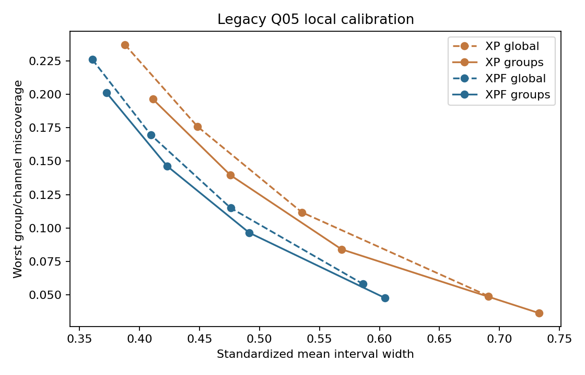
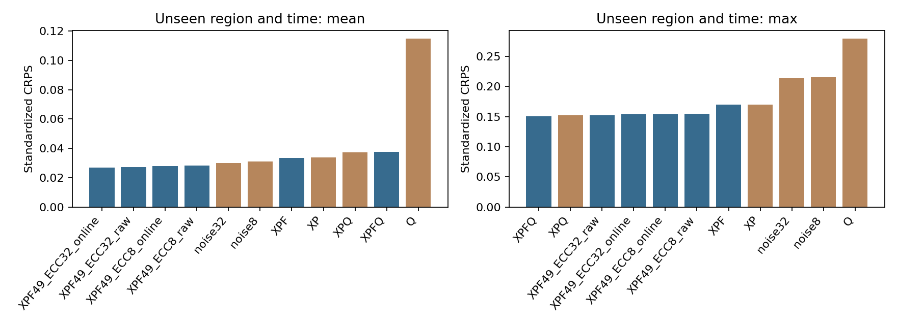

# 基于原版 XPF16 独立双分位头的 RealPDE 后续实验

本报告修正上一轮使用共享分位头的问题。这里的 XPF 是冻结四步 DiPred + 原版16通道风险头：**每个头独立学习一对上下分位数**。原49头及其 F/XP 同结构消融直接读取既有权重；0.2%网格直接重放249个双分位头和一个独立中位数头。所有新增查询头只训练 seed42。数据只用原 RealPDE，没有训练五场景。

## 主要发现

- **原版 XPF49 的 F 确实提供了风险读出价值。** 在开发集、同一 P 锚点下，原始分布 XPF 的CRPS比 XP 和 F 更低。把重排后的分布中位数统一平移到 P 后，XPF 仍优于两个控制；这是事后中心对齐诊断，不能替代固定中心后重新训练，也不能由此证明扩散预训练机制的因果作用。
- **使用真实 XPF 分位结果可改进区域极值查询，但有任务取舍。** 对未见空间区域与未见时间段，XPQ 比同容量 XP 查询头的最大值CRPS从 0.169681 降到 0.152369，下降 10.20%；平均值CRPS却从 0.033658 升到 0.037299。查询头 Q 输入是原XPF16 Q05/Q25/Q49的上下分位残差，而非另一套新风险模型。Q 本身依赖 X、P 和F，不能把增益解释为 F 的单独因果作用。
- **局部风险存在可利用空间，但覆盖与宽度需一起看。** 同一90%校准目标下，XPF分组的平均宽度为0.4915、最差预定义区域/通道覆盖90.36%；XP对应0.5684、91.59%。两者不是同覆盖点，不可宣称同风险条件下XPF已胜出。完整风险—宽度曲线见下。
- 原XPF49边际 + 真正扩散路径秩耦合（ECC）在新查询最大值上优于原生32条路径，但还需要生成真实路径，且不能将经典ECC本身作为新方法。其边际采用49头而非250头，原始/在线校准分别列报。

## 模型和数据

- 原版49头：每头34,004参数，独立预测 Qα 与 Q1−α；98个输出跨头会交叉。CRPS将输出排序、以Q49与Q51平均插入Q50，并假设1%外尾常值。90%覆盖使用Q05自身的上下边界；不是重排后对应索引。
- 0.2%网格：249个独立成对头 + 1个单独中位数头，总计499分位；每头同一819训练窗口、seed42及2000更新；50个既有头按旧协议复用。它的独立中位数和校准状态不同，不能与49头当作同一口径。
- 训练819个窗口／46条轨迹；校准90窗口／10条轨迹；开发108窗口／12条轨迹，三个Re组。九个窗口包含冷启动窗口，在线方法在整块发出后才更新，故与历史测试报告排除冷启动的41窗口结果不可直接混用。
- 后续查询头为相同结构、初始化和4000步的XP、XPF、XPQ、XPFQ、Q。X/P/F池化输入是上轮共同设置；Q为真实冻结Q05/Q25/Q49六个上下界场的空间均值、标准差、最大值。原XPF的输入仍为6个旧基础特征、8个投影F和两个坐标，不能称原头直接读取完整原始X。
- 旧开发轨迹被多次用于研究，这里的结果只能作为探索性筛选；没有新鲜独立测试或正式覆盖保证。样本路径种子是生成ensemble所需随机数，不是多训练种子。

## 原版风险分布与中心分解

数值按原训练u/v标准差归一化，轨迹、窗口、通道等权。`P_aligned`将每个已重排分布整体平移，使中位数等于共同 P，形状不变；因此它需要 P，也改变已发布模型的原始点估计。

| arm | mode | center | crps | median_mse | coverage | width | interval_score |
| --- | --- | --- | --- | --- | --- | --- | --- |
| F | online | P_aligned | 0.082090 | 0.059602 | — | — | — |
| F | online | original | 0.081947 | 0.060264 | 0.894139 | 0.478765 | 0.665186 |
| F | raw | P_aligned | 0.082261 | 0.059602 | — | — | — |
| F | raw | original | 0.082137 | 0.060334 | 0.895120 | 0.472365 | 0.671474 |
| XP | online | P_aligned | 0.082103 | 0.059602 | — | — | — |
| XP | online | original | 0.081772 | 0.059594 | 0.896314 | 0.462146 | 0.666919 |
| XP | raw | P_aligned | 0.082372 | 0.059602 | — | — | — |
| XP | raw | original | 0.082040 | 0.059657 | 0.850889 | 0.430032 | 0.677207 |
| XPF | online | P_aligned | 0.081080 | 0.059602 | — | — | — |
| XPF | online | original | 0.080640 | 0.060175 | 0.895545 | 0.467846 | 0.628713 |
| XPF | raw | P_aligned | 0.081139 | 0.059602 | — | — | — |
| XPF | raw | original | 0.080716 | 0.060236 | 0.890406 | 0.463227 | 0.629647 |
| XPF_grid250 | online | P_aligned | 0.081073 | 0.059602 | — | — | — |
| XPF_grid250 | online | original | 0.080645 | 0.060184 | 0.895545 | 0.467846 | 0.628713 |
| XPF_grid250 | raw | P_aligned | 0.081142 | 0.059602 | — | — | — |
| XPF_grid250 | raw | original | 0.080723 | 0.060249 | 0.890406 | 0.463227 | 0.629647 |

49头和250头直接回放的误差量级，以及具体旧特征比对，见 `verification.json`。49头对照中的F和XP均保留共同P锚点；它们不是完全不依赖P的端到端模型。

## 预定义区域的可靠性

10组根据预测时可得信息确定：全域、三个时距、四象限，以及预测梯度高/低区域。以独立校准轨迹估计 Q05 半宽乘性尺度，对比统一尺度和重叠组最大尺度；下表显示90%目标，完整4个目标见CSV。不存在把像素当独立样本的覆盖保证。

| arm | strategy | target | coverage | width | worst_group_coverage |
| --- | --- | --- | --- | --- | --- |
| XP | global | 0.900000 | 0.915554 | 0.535306 | 0.888244 |
| XP | groups | 0.900000 | 0.931390 | 0.568416 | 0.915930 |
| XPF | global | 0.900000 | 0.903702 | 0.476006 | 0.885035 |
| XPF | groups | 0.900000 | 0.913534 | 0.491534 | 0.903578 |

## 新区域／时间的查询分布

预定义矩形和时段；训练见48种查询，开发分为已见、新区域、新时段、两者同时新。区域时段均值及单个速度分量最大值均逐轨迹评分。新区域和新时段组合的标准化CRPS：

| method | max | mean |
| --- | --- | --- |
| Q | 0.279064 | 0.114741 |
| XP | 0.169681 | 0.033658 |
| XPF | 0.169401 | 0.033479 |
| XPF49_ECC32_online | 0.153745 | 0.026828 |
| XPF49_ECC32_raw | 0.152531 | 0.027262 |
| XPF49_ECC8_online | 0.153944 | 0.027854 |
| XPF49_ECC8_raw | 0.154353 | 0.028314 |
| XPFQ | 0.150803 | 0.037601 |
| XPQ | 0.152369 | 0.037299 |
| noise32 | 0.213378 | 0.029949 |
| noise8 | 0.214962 | 0.031152 |

XPQ相对XP、XPFQ相对XPF的逐轨迹配对结果：

| category | statistic | method | baseline | improvement | ci_low | ci_high | wins | trajectories |
| --- | --- | --- | --- | --- | --- | --- | --- | --- |
| new_both | max | XPFQ | XPF | 0.018598 | 0.003934 | 0.033530 | 9 | 12 |
| new_both | max | XPQ | XP | 0.017313 | 0.006687 | 0.027759 | 10 | 12 |
| new_both | max | XPF | XP | 0.000280 | -0.007404 | 0.008027 | 5 | 12 |
| new_both | max | XPFQ | XP | 0.018878 | 0.006041 | 0.030760 | 10 | 12 |
| new_both | max | XPF49_ECC32_online | noise32 | 0.059633 | 0.034215 | 0.087270 | 11 | 12 |

区间为重采样12条轨迹得到的探索性区间；轨迹共享Re，不能视作独立新Re组的置信区间。XPFQ和XPQ都由全XPF的真实分位输出提供Q，故XPQ不是不依赖F的端到端模型。固定查询模型的50/75/90%最大值阈值来自训练集；新区域＋新时段的事件Brier均值如下（两通道与三个阈值等权）：

| method | brier | prevalence |
| --- | --- | --- |
| Q | 0.035885 | 0.179784 |
| XP | 0.023158 | 0.179784 |
| XPF | 0.021504 | 0.179784 |
| XPF49_ECC32_online | 0.019213 | 0.179784 |
| XPF49_ECC32_raw | 0.018989 | 0.179784 |
| XPF49_ECC8_online | 0.018194 | 0.179784 |
| XPF49_ECC8_raw | 0.018063 | 0.179784 |
| XPFQ | 0.019251 | 0.179784 |
| XPQ | 0.020458 | 0.179784 |
| noise32 | 0.026879 | 0.179784 |
| noise8 | 0.026641 | 0.179784 |

概率可靠性、训练分布阈值与用校准集负例预定10%误报阈值后的实际误报/漏报，分别见 `query/reliability.csv` 和 `query/decisions.csv`。无正例的漏报率保留为空。普通查询头虽然随阈值单调，但并未保证嵌套区域/时间的概率一致：

| method | pairs | fraction | mean_excess | max_excess |
| --- | --- | --- | --- | --- |
| XP | 1058 | 0.026719 | 0.002139 | 0.618809 |
| XPF | 1058 | 0.024302 | 0.001664 | 0.466798 |
| XPQ | 1058 | 0.022324 | 0.001505 | 0.486379 |
| XPFQ | 1058 | 0.019513 | 0.001204 | 0.473560 |
| Q | 1058 | 0.028014 | 0.002841 | 0.926091 |

## 计算与口径

A100、batch1、模型已载入、160个查询共享一次预测；包含四步DiPred、必要时执行3个原版XPF头、汇聚和输出3个分位数：

| method | queries | median_ms | p10_ms | p90_ms | batch | repeats |
| --- | --- | --- | --- | --- | --- | --- |
| XP | 160 | 15.771258 | 15.751619 | 16.811934 | 1 | 10 |
| XPF | 160 | 15.763139 | 15.737334 | 15.794931 | 1 | 10 |
| XPQ | 160 | 37.628638 | 37.442496 | 38.402448 | 1 | 10 |
| XPFQ | 160 | 37.502103 | 37.416981 | 37.618102 | 1 | 10 |

原生8/32路径参考使用前一研究的真实采样，全部查询复用一次样本生成；本次ECC也重新生成真实8/32路径，重排后对区域统计计算经验CRPS。查询分位模型使用99分位积分，ECC／原生ensemble使用有限样本经验CRPS；估计量及是否在线校准不同，结果需按表中方法标签解释。不同进程间耗时会受GPU负载影响，不能以本表声称等可靠性加速。

## 验证与文件

- 对原 `prepare` 的比较：X和P完全一致，最后去噪F误差 0；6个旧基础特征最大误差 4.77e-06（从标准化历史恢复物理量导致浮点舍入）。
- 对历史开发缓存的逐轨迹/通道CRPS回放最大差：7.81e-06；旧原始250网格缓存为未重排分布，而本报告原始分布排序后评分，因此仅在线重排量作直接核对。
- NumPy独立重算查询CRPS最大差 1.29e-08，双重求和重算ECC经验CRPS最大差 4.27e-09；逐级权重散列、单种子、因果反馈和ECC事件包含关系通过。
- `audit/per_group.csv` 和 `audit/grid250_per_group.csv`：原49/250头完整局部审计；`local/per_group.csv`：校准曲线；`query/per_query.csv`、`query/ecc_per_query.csv`：全部逐查询评分；`query/predictions.pt`、`query/ecc_predictions.pt`：预测用于复核。
- 源码与命令见 `../../xpf49_followup_20261116/README.md`。比较有利的现象还需新轨迹、未见工况和固定实验协议确认。若进一步发展查询方法，优先改善均值/极值的冲突、概率一致性和更大查询族，而不是只报告极值CRPS。
